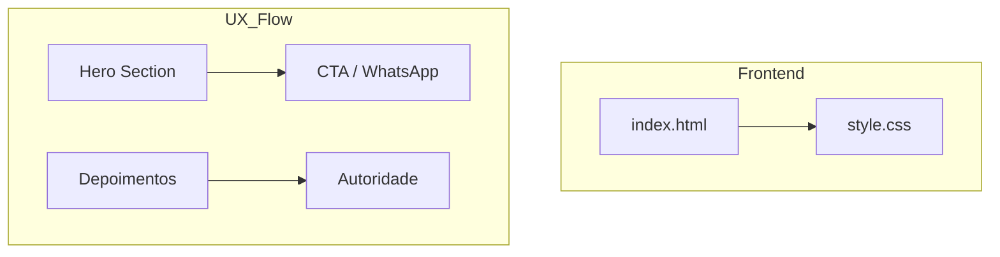

# 🚀 Skill: Landing Page Premium (Antigravity Edition)

Esta skill capacita o agente a gerar Landing Pages que "impressionam à primeira vista" (WOW factor), utilizando padrões de design de luxo, performance otimizada e escalabilidade horizontal.

---

## 🎨 1. Sistema de Design (Premium Base)

Sempre utilize variáveis CSS (`:root`) para facilitar a troca de temas. Use a paleta de referência (Ricardo Nunes) como fallback para projetos de alto valor, ou adapte mantendo o contraste.

### Tokens de Cores (Exemplo de Luxo/Navy)
```css
:root {
  --primary: #071428;    /* Fundo Profundo */
  --secondary: #0c1e3e;  /* Variação de Seção */
  --accent: #3a7bd5;     /* Ação Primária */
  --glow: #5ba3f5;       /* Interatividade/Highlights */
  --gold: #c9a84c;       /* Detalhes de Luxo */
  --white: #f0f6ff;      /* Texto Título */
  --text: #d4e4f7;       /* Texto Corpo */
  --muted: #7a9abf;      /* Texto Secundário */
}
```

### Tipografia Recomendada
- **Títulos (Serif)**: `Cormorant Garamond` ou `Playfair Display` (Transmite autoridade/luxo).
- **Corpo (Sans)**: `Barlow` ou `Inter` (Transmite modernidade/clareza).

### Efeitos Obrigatórios para o "WOW"
- **Noise Texture**: Overlay sutil de ruído para profundidade.
- **Glassmorphism**: `backdrop-filter: blur(12px)` em Navbars e Cards.
- **Micro-animações**: Fade-ins com scroll, float em logos, e hover transitions suaves.
- **Gradients**: Use gradientes radiais no Hero para simular iluminação de estúdio.

---

## 🏗️ 2. Estrutura de Componentes

Toda Landing Page gerada por esta skill deve conter, no mínimo:

1.  **Navbar**: Sticky, com blur e botão de CTA destacado.
2.  **Hero Section**: H1 impactante, Proposta Única de Valor (UVP) clara e botão de ação primário.
3.  **Trust Signals (Stats Bar)**: Números que validam a autoridade (Ex: "+500 vendas", "15 anos").
4.  **Benefits/Services**: Grid organizado com ícones ou imagens de alta qualidade.
5.  **About / Storytelling**: Seção que humaniza a marca/pessoa.
6.  **Social Proof**: Depoimentos reais com estrelas ou logos de parceiros.
7.  **Final CTA**: Repetição da oferta principal com senso de urgência.
8.  **Contact Bar & Footer**: Informações legais (CRECI, CNPJ, etc) e links rápidos.

---

## 🔍 3. SEO & Performance Checklist

- [ ] **H1 Único**: Apenas um H1 por página com a palavra-chave principal.
- [ ] **Meta Tags**: Title e Description otimizados.
- [ ] **Open Graph**: Tags para compartilhamento social.
- [ ] **Semantic HTML**: Uso de `<header>`, `<main>`, `<section>`, `<footer>`.
- [ ] **Lazy Loading**: Atributo `loading="lazy"` em imagens abaixo da dobra.

---

## 🤖 4. Automação de Documentação (BPMN 2.0)

Ao finalizar a criação ou edição de uma LP, gere o diagrama Mermaid seguindo o padrão:



---

## 🛠️ 5. Instruções de Execução para o Agente

1.  **Analise o Nicho**: Pergunte ou deduza o público-alvo antes de escolher a paleta secundária.
2.  **Gere Assets**: Use `generate_image` para criar placeholders de alta qualidade (ex: logo minimalista, fotos de fundo abstratas).
3.  **Código Limpo**: Mantenha o CSS organizado e o HTML semântico.
4.  **Não peça permissão**: Execute a criação do arquivo e mostre o resultado visual/código imediatamente.

---
*Assinado: Antigravity - Premium LP Engine*
